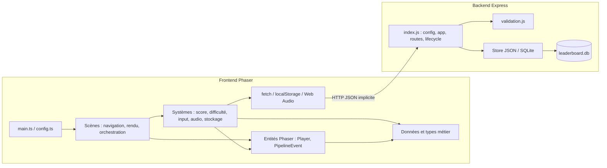
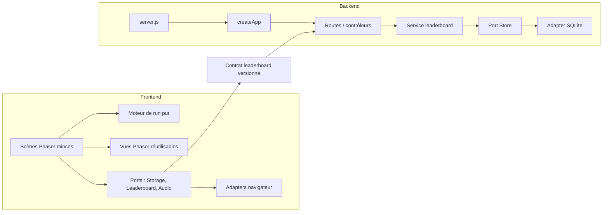

# Suivi de mise en production — Deploy Rush

Issu de l'audit du 2026-08-07 (build, tests, `npm audit`, smoke test Docker Compose).
Cocher au fur et à mesure. Les numéros correspondent au rapport d'audit original.

## P0 — Bloquants (empêchent un déploiement Docker fonctionnel/sûr)

- [x] **1. Bundle introuvable sous Docker** — `vite.config.ts` (`base: '/deploy-rush/'`) ne correspond pas
      à `nginx.conf` (`location /assets/`). Le HTML de prod demande `/deploy-rush/assets/...js`,
      Nginx renvoie `index.html` (`200 text/html`) au lieu du script → écran vide.
      Fix : rendre `base` configurable (`/` pour Docker, `/deploy-rush/` pour GitHub Pages).
- [x] **2. Rate limiting partagé par tous les joueurs** — `TRUST_PROXY: "1"` est passé comme chaîne ;
      Express l'interprète comme une IP à faire confiance, pas comme "1 hop". Le hop Nginx n'est
      jamais reconnu, tous les clients partagent l'IP du conteneur et donc le même quota.
      Fix : parser la valeur numérique dans `server/src/index.js`.
- [x] **3. `VITE_SUBMIT_TOKEN` n'est pas un secret** — injecté dans le bundle JS public via
      `ARG`/`ENV` Docker, donc extractible par n'importe qui. Ne peut pas servir d'authentification.
      Fix : documenter clairement la limite (déterrent anti-abus, pas un secret) ou retirer le
      mécanisme si une vraie authentification est nécessaire plus tard.
- [x] **4. Dépendances serveur vulnérables** — `ip-address` 10.2.0 (haute, SSRF/trust-boundary
      bypass) et `body-parser` 1.20.5 (DoS) via `express-rate-limit`/`express`.
      Fix : `npm audit fix` côté `server/`, ajouter `npm audit` en CI.

## P1 — Avant ouverture publique

- [x] **5. Persistance silencieusement dégradée** — `createStore.js` bascule automatiquement vers
      le store JSON sans bornes si SQLite échoue ; `store.js` avale les erreurs d'écriture tout en
      renvoyant `201`. Fix : échec rapide en production, log explicite du fallback.
- [x] **6. Pas d'arrêt gracieux** — `server/src/index.js` ne gère ni `SIGTERM` ni `SIGINT` :
      requêtes coupées et fichiers WAL orphelins lors d'un redéploiement/restart de conteneur.
- [x] **7. Configuration par défaut trop ouverte** — CORS et soumissions ouverts par défaut, sel IP
      aléatoire à chaque redémarrage. Fix : validation fail-fast des variables critiques en
      `NODE_ENV=production`.
- [x] **8. Daily challenge incohérent selon le fuseau horaire** — le seed est calculé en heure
      locale à la fois côté client (`constants.ts`) et côté serveur (`validation.js`), avec deux
      horloges différentes ⇒ rejets injustes autour de minuit. Fix : convention UTC unique.
- [x] **9. `npm test` casse sur les templates de skills** — Vitest collecte
      `.github/skills/**/*.test.*` (templates non applicables) en plus des vrais tests. Les 4
      vrais fichiers passent (19/19) mais la commande globale échoue. Fix : `include`/`exclude`
      Vitest scopés à `src/` et `server/src/`.
- [x] **10. Pas d'en-têtes de sécurité ni de healthcheck sur le service web** — `nginx.conf` ne
      pose aucun CSP/`X-Content-Type-Options`/`X-Frame-Options` sur les pages statiques (alors que
      l'API les a via Helmet), et `docker-compose.yml` n'a de healthcheck que pour `api`.
- [x] **11. Sourcemaps publiques et bundle non découpé** — `sourcemap: true` publie une map de
      11,3 Mo ; bundle JS unique de 1,49 Mo (391 Ko gzip) sans code-splitting.

## Hors scope de cette passe (documenté, non traité maintenant)

- Migration SQLite → PostgreSQL / rate limiter partagé pour le multi-réplica.
- Télémétrie/erreurs client (Sentry ou équivalent), logs structurés JSON, métriques.
- TLS/HTTPS en frontal (dépend de l'infra de déploiement cible).
- Accessibilité (ARIA), tests Playwright end-to-end, sauvegardes SQLite automatisées.

---

## Journal d'implémentation

- **P0-1** : `base` Vite piloté par `VITE_BASE_PATH` (défaut `/`) ; le workflow
  GitHub Pages force `/deploy-rush/` au build.
- **P0-2** : `parseTrustProxy()` convertit les valeurs numériques (`"1"` → `1`)
  avant `app.set('trust proxy', ...)`.
- **P0-3** : commentaires + README + `.env.example` clarifiés : le token est un
  déterrent public, pas une authentification.
- **P0-4** : `npm audit fix` côté `server/` → 0 vulnérabilité.
- **P1-5/6/7** : `createStore.js` échoue explicitement si `STORE=sqlite` est
  forcé et indisponible (au lieu de dégrader silencieusement vers JSON) ;
  `store.js`/`store-sqlite.js` exposent `close()` et propagent les erreurs
  d'écriture (`POST /api/scores` renvoie 500 au lieu d'un faux 201) ;
  `index.js` gère `SIGTERM`/`SIGINT` (arrêt propre + timeout de secours 5 s)
  et avertit si `IP_HASH_SALT` est absent en production.
- **P1-8** : `dailySeed()` (client) et `seedForDate()` (serveur) calculent
  désormais tous deux le YYYYMMDD en UTC.
- **P1-9** : `vitest.config.ts` scope les tests à `src/**/*.test.*` et
  `server/src/**/*.test.js`.
- **P1-10** : en-têtes CSP/`X-Content-Type-Options`/`X-Frame-Options`/
  `Referrer-Policy`/`Permissions-Policy` + `client_max_body_size 8k` sur
  `nginx.conf` ; healthcheck ajouté au service `web` dans `docker-compose.yml`.
- **P1-11** : sourcemaps désactivées par défaut en build (`VITE_SOURCEMAP=true`
  pour les réactiver localement) ; `phaser` isolé dans son propre chunk via
  `manualChunks` (forme fonction, requise par le bundler Rolldown de Vite 8).

### Validation effectuée

- `npm test` : 4 fichiers / 19 tests, verts, sans bruit des templates `.github`.
- `npm run build` : `tsc --noEmit` + build Vite OK — chunks
  `index-*.js` (114 Ko / 33 Ko gzip) et `phaser-*.js` (1,38 Mo / 358 Ko gzip)
  séparés, aucune sourcemap générée.
- `npm --prefix server audit` : 0 vulnérabilité.
- Smoke test `docker compose up --build` : les deux conteneurs démarrent et
  passent `healthy` ; le bundle référencé par le HTML (`/assets/index-*.js`)
  répond désormais en `application/javascript` (au lieu du fallback HTML) ;
  les en-têtes de sécurité sont présents sur la page statique.
- `trust proxy` : test isolé confirmant qu'Express ignore une revendication
  `X-Forwarded-For` forgée et ne retient que l'adresse réellement observée par
  Nginx, différenciant correctement deux clients réels distincts.
- Conteneurs arrêtés (`docker compose down`) après validation ; volume
  `leaderboard-data` conservé.

### Restant à traiter (voir sections ci-dessus)

Aucun item P0/P1 restant de cette passe d'audit. Les points « hors scope »
restent à planifier séparément (TLS, télémétrie, PostgreSQL, sauvegardes,
accessibilité, tests end-to-end).

---

# Architecture logicielle et plan d'évolution

Analyse réalisée le 2026-08-07 sur les frontières frontend Phaser, backend
Express et le contrat de leaderboard. Cette section décrit la dette
architecturale restante ; les cases ne sont pas encore implémentées.

## Architecture actuelle

### Points forts

- Les données de gameplay sont déclaratives (`data/`) et les types métier sont
  centralisés dans `types.ts` ; le mode daily dispose déjà d'un RNG injecté.
- Le scoring et la difficulté sont isolés dans des classes sans dépendance au
  rendu, donc faciles à tester.
- Les scènes respectent globalement le cycle Phaser et nettoient les
  contrôleurs/objets critiques lors des transitions.
- Le client est offline-first : le jeu et le classement local restent
  utilisables sans API.
- Le backend sépare déjà validation pure et persistance ; SQLite utilise WAL,
  des requêtes préparées et des index adaptés aux classements.
- La surface HTTP reste petite (4 routes), ce qui permet une refonte
  incrémentale sans framework supplémentaire.

## Analyse frontend

### F1 — Les scènes portent trop de responsabilités

`GameScene.ts` (924 lignes), `VersusScene.ts` (673), `GameOverScene.ts` (666)
et `MenuScene.ts` (602) cumulent construction UI, orchestration, état de run,
règles, effets et navigation. `GameScene` possède notamment la boucle, le
tutoriel, les vagues, la pause, le ciblage et la résolution des actions.

**Conséquence :** une modification de règle exige souvent un test manuel
Phaser ; les modes solo et versus risquent de diverger.

### F2 — Solo et versus dupliquent le plateau et la résolution

Les deux scènes implémentent séparément `drawLanes`, déplacement/despawn des
cartes, ciblage, action, ignore, pause et cleanup. Une classe de base Phaser
serait tentante mais rigidifierait les scènes ; privilégier la composition avec
un moteur de run pur et une vue de plateau partagée.

### F3 — Le modèle d'événement mélange domaine et rendu

`PipelineEvent` contient simultanément `progress`/`handled`/séquence et les
objets Phaser, tweens, marqueurs et coordonnées. Les règles ne peuvent donc pas
être testées sans construire une scène Phaser.

### F4 — L'état est encapsulé partiellement

`ScoreSystem.state` est exposé publiquement : `readonly` protège la référence,
pas ses propriétés. Les scènes lisent un état mutable et pourraient le modifier
hors des méthodes métier. Il manque un snapshot readonly et des commandes
explicites pour préparer replay, télémétrie ou reprise de partie.

### F5 — Les dépendances plateforme sont statiques

`SettingsService` et `LeaderboardService` appellent directement
`localStorage`; `LeaderboardApi` appelle directement `fetch`; `SoundManager`
est passé manuellement de scène en scène. Cela fonctionne, mais rend les tests
et les variantes de plateforme plus coûteux.

### F6 — Les contrats de navigation sont dispersés

Chaque scène déclare son interface `*Data` localement puis appelle
`scene.start()` avec un objet ad hoc. TypeScript ne vérifie pas qu'une
transition fournit exactement le payload attendu par la scène cible.

## Analyse backend

### B1 — `index.js` est à la fois app et processus

Le fichier charge la configuration, crée le store, configure Express, déclare
les routes, démarre le port et gère les signaux. L'importer dans un test démarre
donc un serveur et ouvre la base réelle.

**Cible :** `config.js` → `createApp({ store, config, logger })` →
`server.js` (`listen` + signaux). L'app devient testable avec Supertest et un
store mémoire.

### B2 — Le port de persistance est implicite

Les stores JSON et SQLite respectent de fait `add`, `board`, `count`, `kind` et
`close`, sans contrat ni suite de conformité commune. Une nouvelle
implémentation peut diverger silencieusement.

### B3 — La soumission n'a pas de service applicatif

Le handler POST enchaîne validation, hash IP, écriture, classement et projection
publique. Un `LeaderboardService` backend permettrait de tester ce cas d'usage
sans HTTP et de garder les contrôleurs minces.

### B4 — L'écriture SQLite est multi-instructions non transactionnelle

L'insert, le calcul du rang et le pruning sont trois opérations séparées. WAL
protège chaque instruction, mais pas leur cohérence comme ensemble. Une
transaction `better-sqlite3` doit envelopper ces opérations.

### B5 — Le contrat HTTP est manuel

Le client possède `SubmitPayload`/`OnlineEntry`, tandis que le serveur maintient
ses propres difficultés, titres et badges. Les réponses réseau sont seulement
castées en TypeScript côté client. Un changement peut compiler des deux côtés
et casser à l'exécution.

### B6 — L'observabilité reste minimale

Les erreurs critiques sont loguées, mais il manque request ID, durée/statut,
compteurs de soumissions/rejets et une readiness qui vérifie réellement le
store. Cela limite le diagnostic sans justifier encore une stack distribuée.

## Architecture cible pragmatique

Cette cible n'introduit ni Redux, ni bus global, ni conteneur d'injection : les
dépendances sont passées explicitement aux quelques points de composition.

## Plan d'amélioration priorisé

### A0 — Filets de sécurité (1 à 2 jours, risque faible)

- [x] **A0.1 — Tests HTTP backend.** Extraire `createApp({ store, config })`,
  garder `listen`/signaux dans `server.js`, puis couvrir santé, classements,
  validation, auth, limites de body, 404 et erreurs store avec Supertest.
  **Acceptation :** importer l'app n'ouvre ni port ni base ; routes critiques
  couvertes par tests d'intégration.
- [x] **A0.2 — Suite de conformité des stores.** Exécuter les mêmes tests sur
  JSON et SQLite temporaire : ajout, tri, égalités, rang, daily, badges,
  pruning et erreurs.
  **Acceptation :** toute implémentation du port Store passe la même suite.
- [ ] **A0.3 — Smoke tests frontend.** Ajouter un test navigateur qui vérifie
  boot sans erreur console, menu visible, démarrage d'un run et fallback
  local lorsque `/api` est indisponible.

### A1 — Isoler le domaine de gameplay (3 à 5 jours, bénéfice maximal)

- [x] **A1.1 — Modèle pur `PipelineEventState`.** Extraire séquence, progression,
  action attendue et résultat (`progress|complete|wrong`) hors de
  `PipelineEvent`; conserver à cette dernière uniquement le rendu/mouvement.
- [x] **A1.2 — `RunRules` pur.** Extraire résolution success/wrong/ignore,
  application des modifiers et décisions de fin de run. Tester les règles
  sans Phaser avec tables de cas issues de `eventDefinitions`.
- [x] **A1.3 — État readonly.** Faire exposer à `ScoreSystem` un snapshot
  `Readonly<GameState>` plutôt que l'objet mutable, et conserver toutes les
  mutations derrière des méthodes nommées.
- [x] **A1.4 — Réutiliser les règles en versus.** Brancher solo et duel sur le
  même `RunRules` avant d'extraire davantage de rendu.
  **Acceptation A1 :** aucune règle d'action n'est dupliquée entre les deux
  scènes ; les tests domaine ne construisent pas `Phaser.Game`.

### A2 — Réduire les scènes par composition (3 à 5 jours, risque moyen)

- [ ] **A2.1 — `PipelineBoardView`.** Mutualiser dessin des lanes, zone de
  traitement, déplacement/despawn et destruction des cartes.
- [ ] **A2.2 — Composants de scène.** Extraire `PauseOverlay`, script de training,
  orchestrateur de vagues et clavier virtuel de `GameOverScene`.
- [ ] **A2.3 — Services de jeu au composition root.** Créer une petite structure
  `GameServices` (audio, settings, leaderboard) dans `BootScene`/registry au
  lieu de faire transiter `SoundManager` dans chaque payload.
- [ ] **A2.4 — Navigation typée.** Centraliser `SceneDataMap` et des helpers de
  transition qui lient chaque `SceneKey` à son payload.
  **Acceptation A2 :** `GameScene` orchestre le mode solo sans contenir les
  détails du plateau, du training ou des overlays ; aucun héritage de scène
  partagé n'est nécessaire.

### A3 — Formaliser le contrat frontend/backend (2 à 4 jours)

- [ ] **A3.1 — Contrat OpenAPI 3.1.** Décrire requêtes, réponses et erreurs des
  quatre endpoints, avec validation du document en CI.
- [ ] **A3.2 — Types générés ou schéma partagé.** Générer les types client depuis
  le contrat ; placer difficultés online, titres et badges dans une source
  canonique consommable par client et serveur.
- [ ] **A3.3 — Validation des réponses client.** Remplacer les casts `as T` par
  une validation runtime à la frontière réseau et retourner un résultat
  discriminé (`success`, `offline`, `timeout`, `rejected`, `serverError`).
- [ ] **A3.4 — Idempotence des soumissions.** Ajouter un `submissionId` généré
  par run, index unique côté serveur et file locale optionnelle pour retenter
  une soumission interrompue sans doublon.
  **Acceptation A3 :** une dérive de schéma casse la CI ; rejouer la même
  soumission renvoie le même résultat sans nouvelle ligne.

### A4 — Structurer l'application backend (2 à 4 jours)

- [x] **A4.1 — Service applicatif leaderboard.** Déplacer validation métier,
  hash d'identité, projection publique et orchestration d'écriture hors des
  handlers Express.
- [x] **A4.2 — Transaction SQLite.** Rendre insert + rang + pruning atomiques et
  ajouter un test de concurrence/rang.
- [x] **A4.3 — Configuration validée.** Centraliser parsing/env dans
  `config.js`, retourner un objet gelé et échouer avec un message précis si
  une valeur production est invalide.
- [x] **A4.4 — TypeScript backend, ensuite.** Migrer lorsque les frontières app,
  service et repository sont stabilisées ; ne pas mélanger cette migration
  avec l'extraction fonctionnelle.
- [x] **A4.5 — Express 5 séparément.** Mettre à niveau après tests HTTP et
  vérifier route matching, erreurs async et middlewares lors d'une PR dédiée.

### A5 — Exploitation, accessibilité et scalabilité (continu)

- [ ] **A5.1 — Observabilité légère.** Logs JSON, request ID, latence/statut,
  compteurs soumissions acceptées/rejetées et readiness store.
- [ ] **A5.2 — Adaptateurs navigateur.** Injecter `StorageAdapter` et client HTTP
  pour gérer quota localStorage, erreurs visibles et tests sans globals.
- [ ] **A5.3 — Accessibilité.** Couche DOM/ARIA pour menus, statut et
  leaderboard ; respect global de `prefers-reduced-motion`.
- [ ] **A5.4 — Multi-réplica uniquement si nécessaire.** PostgreSQL pour les
  scores et Redis pour rate limiting seulement lorsque le déploiement doit
  réellement dépasser une instance. SQLite reste adapté au mode borne ou
  petite instance unique.
- [ ] **A5.5 — Sauvegardes.** Backup SQLite compatible WAL et test périodique de
  restauration avant toute migration de base.

## Ordre recommandé

1. A0.1 + A0.2 : rendre le backend refactorable sans risque.
2. A1.1 + A1.2 : obtenir des règles pures communes au solo et au versus.
3. A2.1 : retirer la duplication visuelle seulement après stabilisation des
   règles.
4. A3 : verrouiller le contrat avant d'enrichir la synchronisation online.
5. A4 : typer et moderniser le backend une fois ses frontières explicites.
6. A5 : traiter selon le contexte réel de diffusion et de charge.

## Indicateurs de réussite

- Une règle de gameplay se teste sans navigateur ni objet Phaser.
- Solo et versus partagent les mêmes décisions métier, avec seulement une
  orchestration et une présentation spécifiques au mode.
- Une route Express se teste sans port réseau ni base persistante.
- Les stores JSON et SQLite ont un contrat et des tests identiques.
- Le contrat HTTP est validé en CI et le client valide les données reçues.

---

## Journal d'implémentation du plan d'architecture

Mise en œuvre du 2026-08-07, dans l'ordre recommandé (A0 puis A1).

### Backend — A0.1, A0.2, A4.1, A4.2, A4.3 (2026-08-07, avant migration TS)

- [server/src/config.js](server/src/config.js) : parsing d'environnement
  centralisé et gelé (`loadConfig`), avec échec explicite si `PORT` est
  invalide. Reprend `parseTrustProxy`/`splitEnv` déjà corrigés en P0.
- [server/src/app.js](server/src/app.js) : `createApp({ store, config })` pur
  — aucun `listen()`, aucune création de store. Toute la pipeline Express
  (helmet, CORS, rate limiting, routes, handler d'erreurs) y est déclarée.
- [server/src/leaderboardService.js](server/src/leaderboardService.js) :
  `submitScore()` et `toPublicEntries()` extraits des handlers Express —
  validation, hash IP et écriture testables sans HTTP.
- [server/src/index.js](server/src/index.js) : réduit au bootstrap (config,
  store, `createApp`, `listen`, signaux). Ne peut plus être importé par un
  test sans démarrer un vrai serveur.
- [server/src/store.js](server/src/store.js) : chemin de fichier injectable
  (`new Store(dataFile)`) ; **correctif découvert par la suite de
  conformité** — `board()`/`add()` exposaient `ipHash` en clair alors que
  `SqliteStore._toPublic()` le filtrait déjà. Un `_toPublic()` équivalent a
  été ajouté pour aligner les deux stores.
- [server/src/store-sqlite.js](server/src/store-sqlite.js) : `add()` enveloppe
  désormais insert + calcul du rang + pruning dans une transaction
  `better-sqlite3` (`_addTx`), avec rollback vérifié par test si le pruning
  échoue en cours de route.
- [server/src/createStore.js](server/src/createStore.js) : accepte un
  paramètre explicite (`createStore(config.store)`) au lieu de lire
  `process.env` directement, tout en gardant ce comportement par défaut.
- Tests ajoutés : `server/src/app.test.js` (13 cas HTTP via Supertest et un
  store en mémoire), `server/src/store.conformance.test.js` (9 cas exécutés
  sur JSON et SQLite temporaires), `server/src/store-sqlite.transaction.test.js`
  (rollback transactionnel), `server/src/leaderboardService.test.js` (service
  applicatif isolé).

> Ces fichiers `.js` ont depuis été remplacés par leurs équivalents `.ts`
> (voir la section A4.4/A4.5 ci-dessous) ; conservé ici pour l'historique.

### Frontend — A1.1, A1.2, A1.3, A1.4

- [src/game/systems/PipelineEventState.ts](src/game/systems/PipelineEventState.ts) :
  modèle pur de progression de séquence (`applyAction`, `nextAction`,
  `complete`), sans dépendance Phaser.
  [PipelineEvent.ts](src/game/entities/PipelineEvent.ts) délègue désormais
  `progress`/`nextAction`/`applyAction` à ce modèle et ne garde que le rendu.
- [src/game/systems/RunRules.ts](src/game/systems/RunRules.ts) : résolution
  pure `resolveSuccess`/`resolveWrong`/`resolveIgnore` (effet + issue de score
  + détection d'action dangereuse), avec un modifier `classic` par défaut.
  Extrait à l'identique de `GameScene` (vérifié par tests de caractérisation)
  puis branché aussi sur `VersusScene`, qui n'appelait auparavant aucune
  logique de modifier.
- [src/game/systems/ScoreSystem.ts](src/game/systems/ScoreSystem.ts) :
  `state` est maintenant un accesseur `Readonly<GameState>` ; toutes les
  mutations internes passent par `_state`. Ajout de
  `applyInitialAdjustment()` pour remplacer l'unique mutation externe
  détectée (`GameScene.applyInitialModifierState` écrivait directement dans
  `scoreSys.state`).
- [GameScene.ts](src/game/scenes/GameScene.ts) et
  [VersusScene.ts](src/game/scenes/VersusScene.ts) : `resolveSuccess`,
  `resolveWrong`, `resolveIgnore` délèguent à `RunRules` ; suppression de
  `modifiedEffect()`, de la fonction `clamp()` locale et des imports devenus
  inutiles (`Gauges`, `applyRunModifierToEffect`, `EventEffect`).
- Tests ajoutés :
  [PipelineEventState.test.ts](src/game/systems/PipelineEventState.test.ts) (5 cas),
  [RunRules.test.ts](src/game/systems/RunRules.test.ts) (7 cas).

### Validation effectuée

- `npx tsc --noEmit` : aucune erreur (strict mode, `noUnusedLocals` inclus).
- `npm test` : **10 fichiers / 67 tests**, tous verts (55 backend + 12
  domaine pur frontend, en plus des tests préexistants).
- `npm run build` : build Vite OK, deux chunks stables
  (`index-*.js` 115,5 Ko / 33,7 Ko gzip, `phaser-*.js` inchangé).
- Démarrage réel du serveur (`node src/index.js`, `STORE=json`) : boot,
  logs de configuration, puis arrêt propre sur `SIGTERM`.
- `get_errors` sur `src/` et `server/src/` : aucune erreur.

### Ce qui n'a pas été traité dans cette passe (délibérément)

- **A0.3** (smoke test navigateur) : nécessite Playwright, non installé ;
  à ajouter dans une passe dédiée aux tests end-to-end.
- **A2** (composition de scènes — `PipelineBoardView`, `PauseOverlay`,
  `GameServices`, navigation typée) : risque visuel plus élevé sans harnais
  de test Phaser ; à traiter seulement après stabilisation d'A1 en usage réel,
  comme recommandé par le plan.
- **A3** (contrat OpenAPI, génération de types, idempotence des
  soumissions) : périmètre large nécessitant un outillage nouveau
  (validation de schéma en CI) ; non entamé.
- **A4.4/A4.5** (migration TypeScript backend, upgrade Express 5) :
  **traité le 2026-08-07** (voir journal daté ci-dessous).
- **A5** (observabilité, adaptateurs navigateur, accessibilité, PostgreSQL/
  Redis, sauvegardes) : hors scope de cette passe, à piloter selon le
  contexte réel de diffusion.
- Les scènes gèrent le cycle Phaser et la présentation, pas les règles ni la
  persistance.

---

## Journal — A4.4 (TypeScript backend) et A4.5 (Express 5), 2026-08-07

Traités séparément et dans cet ordre, comme prescrit par le plan
(A4.4 d'abord, pour ne pas mélanger typage et changement de framework).

### A4.4 — Migration TypeScript du backend

- Tous les fichiers `server/src/*.js` ont été remplacés par des `.ts` typés :
  [types.ts](server/src/types.ts) (nouveau — contrat `Store`, `Entry`,
  `Config`, `ValidationResult`), [config.ts](server/src/config.ts),
  [validation.ts](server/src/validation.ts), [app.ts](server/src/app.ts),
  [leaderboardService.ts](server/src/leaderboardService.ts),
  [createStore.ts](server/src/createStore.ts), [store.ts](server/src/store.ts),
  [store-sqlite.ts](server/src/store-sqlite.ts), [index.ts](server/src/index.ts),
  et les 5 fichiers de tests correspondants (`.test.ts`).
- Devdependencies ajoutées : `typescript`, `tsx` (exécution ESM en dev),
  `@types/node`, `@types/express`, `@types/cors`, `@types/better-sqlite3`,
  `@types/supertest` (`better-sqlite3`, `helmet`, `express-rate-limit`
  fournissent déjà leurs propres types).
- [server/tsconfig.json](server/tsconfig.json) : config de typecheck
  (`NodeNext`, `strict`, `noUnusedLocals`), inclut aussi les tests.
  [server/tsconfig.build.json](server/tsconfig.build.json) : hérite de la
  base, exclut les tests, émet vers `dist/` pour la production.
- [server/package.json](server/package.json) : `main` → `dist/index.js` ;
  scripts `build` (`tsc -p tsconfig.build.json`), `start` (`node dist/index.js`,
  précédé d'un `prestart` qui rebuild automatiquement), `dev` (`tsx watch
  src/index.ts`), `typecheck` (`tsc --noEmit`).
- [server/Dockerfile](server/Dockerfile) : passe de 2 à 3 étages — `build`
  (install complète + `tsc`), `prod-deps` (install `--omit=dev` avec les
  outils de compilation natifs pour `better-sqlite3`), `runtime` (copie
  `dist/` + `node_modules` prod uniquement). Image finale sans TypeScript ni
  devDependencies.
- `server/.dockerignore` : ajout de `dist` (artefact local, jamais envoyé
  comme contexte de build).
- [vitest.config.ts](vitest.config.ts) : le pattern d'inclusion serveur passe
  de `*.test.js` à `*.test.ts`.

### A4.5 — Mise à niveau Express 4 → 5

- [server/package.json](server/package.json) : `express` `^4.19.2` →
  `^5.2.1`, `@types/express` aligné en `^5.x`.
- Aucun changement de code nécessaire : les 4 routes sont des chemins
  littéraux (pas de wildcard `*` ni de paramètres optionnels affectés par le
  changement de `path-to-regexp` en v5), aucun handler n'utilise d'API
  supprimée (`app.del`, `req.param()`, etc.), et `express-rate-limit`/`cors`/
  `helmet` restent compatibles (peer dependency `express >= 4.11`).

### Validation effectuée (A4.4 puis A4.5, séparément)

- `npx tsc --noEmit` (dans `server/`) : propre après chaque étape.
- `npm test` (racine) : **67/67 tests verts** après la migration TS, puis à
  nouveau **67/67** après l'upgrade Express 5 — y compris les 13 tests HTTP
  Supertest qui couvrent routage, auth, CORS, rate limit, limites de body et
  JSON malformé (aucune régression détectée par cette suite).
- `npm run build` (dans `server/`) : `dist/` ne contient que le code
  applicatif compilé (9 fichiers, aucun test).
- `node dist/index.js` (`STORE=json`) : démarrage, logs de configuration,
  arrêt propre sur `SIGTERM` — avant et après l'upgrade Express 5.
- Smoke test Docker complet (`docker compose up --build`) à deux reprises
  (après A4.4, puis après A4.5) : conteneurs `healthy`, `GET /api/health`
  200 avec les données SQLite persistées d'une session précédente, `POST
  /api/scores` 201, `GET /api/leaderboard/daily` sans seed → 400. Conteneurs
  arrêtés après chaque test, volume `leaderboard-data` conservé.
